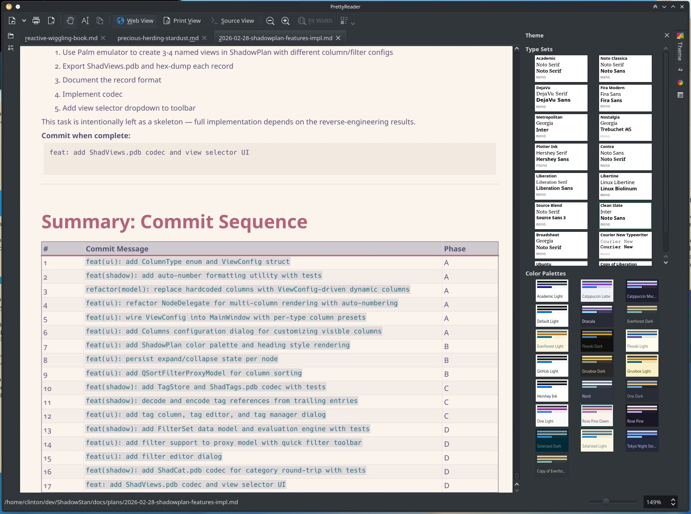

# Penelope



Penelope is a Markdown reader for KDE with paginated PDF preview, a continuous
reader, source editing, and configurable typography.

It parses Markdown with MD4C, shapes text with HarfBuzz, finds line breaks with
ICU, and lays out a semantic content model. Its PDF writer embeds subsetted
fonts; Poppler provides the preview through an asynchronous render cache.
Reader composition runs in a worker with a bounded request queue and shaping
cache. Source edits refresh the reader when returning from source view.
Both reader modes use the shared content and layout pipeline.

Features include:

- Tabs, a heading-based table of contents, file browser, and saved sessions.
- Source editing and atomic Save. Files are watched through Qt: an unmodified
  file reloads automatically (configurable) while keeping the reading and
  editing position, and a change to an edited file raises an in-tab
  Reload/Ignore prompt instead of replacing the buffer. Deleted files are
  reported the same way.
- Headings, styled text, links, lists/task lists, quotes, code highlighting,
  tables with repeated headers across pages, and images with transparency.
- Paragraph/character styles, themes, palettes, page templates, and configurable
  page sizes, orientation and margins.
- First/odd/even headers and footers with page, filename, title and date fields.
- Endnotes from PHP Markdown Extra footnote syntax, with configurable numbering
  and separators; English hyphenation with bundled libhyphen dictionaries.
- Six page arrangements, zoom/panning, source-region text selection, and
  plain-text, Markdown and styled RTF clipboard output.
- Per-file view state and code-language overrides, configurable code-highlight
  themes, PDF/RTF export, and printing.

Some layout capabilities remain incomplete: page-bottom footnotes, per-page
note numbering, page-specific body margins, oversized table-row splitting,
and full inline-media/math rendering. See the
[maintenance audit](docs/2026-10-03-maintenance-audit.md) for repaired defects,
verification coverage and remaining limitations, and the
[Markoff integration analysis](docs/2026-10-03-markoff-port-analysis.md) for the
proposed reader/PDF library extraction.

The current implementation plan is the [ebook-reader roadmap](docs/2026-10-17-ebook-reader-roadmap.md):
typeset the visible range, keep it, and resume. The [step list](docs/2026-10-17-ebook-reader-tasks.md)
is the order to implement it in. Do one step at a time. The [long-document benchmark](docs/2026-10-17-long-document-benchmark.md)
is the measurement for that work. The [composition implementation](docs/2026-10-04-composition-implementation.md)
describes the worker already in place. The [October task list](docs/2026-10-04-performance-tasks.md)
is superseded by the roadmap. The [legacy renderer removal](docs/2026-10-04-legacy-renderer-removal.md)
records the consolidation of readers, exports and clipboard conversion.

## Building and testing

```sh
cmake -S . -B build -DCMAKE_BUILD_TYPE=RelWithDebInfo
cmake --build build
ctest --test-dir build --output-on-failure
```

Tests use Qt Test and run offscreen with isolated settings. Use
`-DBUILD_TESTING=OFF` for an application-only build.

### Dependencies

Qt 6.6+, KDE Frameworks 6, Poppler (Qt6), FreeType, HarfBuzz (with ICU and subset
modules), ICU, fontconfig, libhyphen, md4c, zlib. Qt Test is needed for tests.

On Arch/Manjaro:

```sh
pacman -S qt6-base extra-cmake-modules ki18n kcoreaddons kxmlgui kiconthemes \
  kconfigwidgets kconfig kio syntax-highlighting poppler-qt6 freetype2 \
  harfbuzz harfbuzz-icu icu fontconfig hyphen md4c zlib
```

## License

GPLv3. See [COPYING](COPYING) and the third-party notices in [LICENSES](LICENSES).
