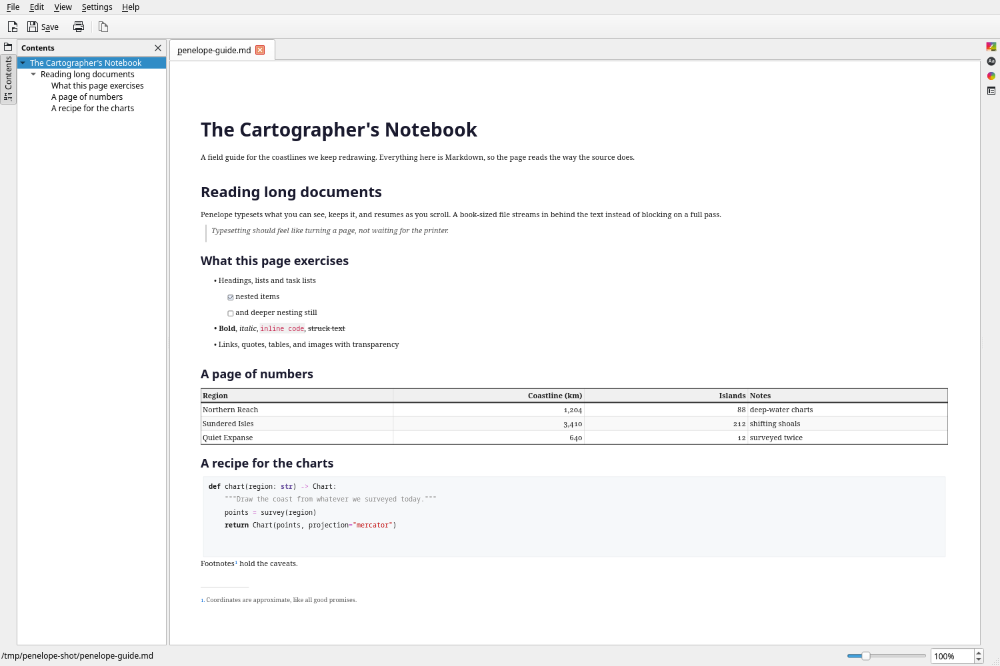
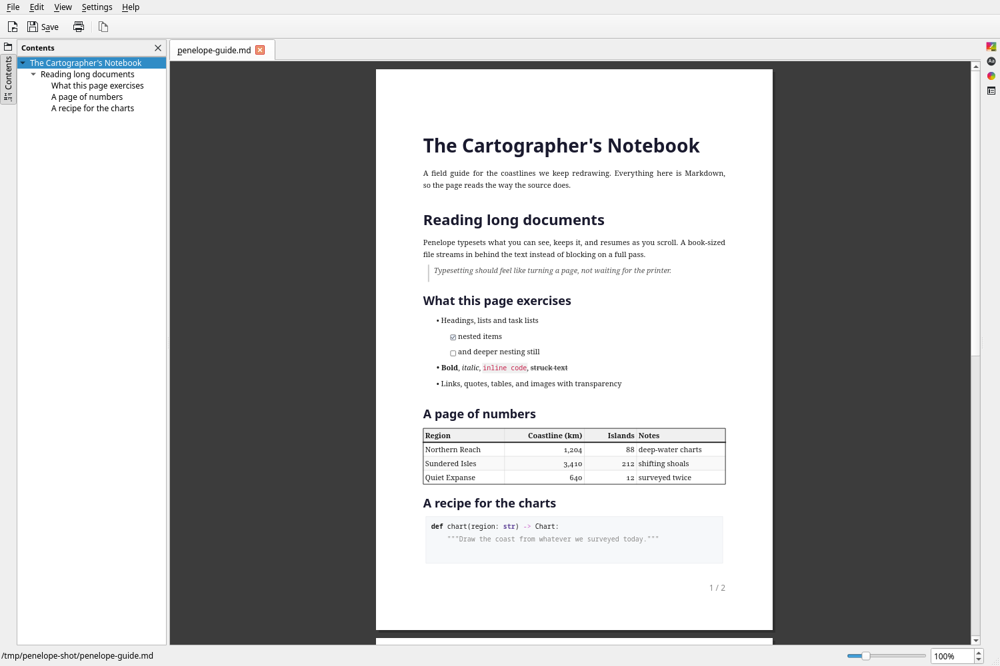

# Penelope

Penelope is a Markdown reader for KDE. It shows a document as a continuous
column or as paginated pages, switches to a source editor without losing your
place, and lets you tune the typography down to individual styles.



It parses Markdown with MD4C, shapes text with HarfBuzz, breaks lines with ICU,
and lays out a semantic content model. Reader composition runs on a worker
thread: a long document composes its first screenfuls immediately and keeps
extending the page as you scroll. The PDF writer embeds subsetted fonts.

## Features

**Reading**

- Web, Print and Source views, switchable at any time.
- Continuous scrolling or six page arrangements: Continuous Scroll, Single
  Page, Facing Pages, Facing Pages (First Alone), Continuous Facing, and
  Continuous Facing (First Alone).
- Zoom from the toolbar, the status bar or Ctrl + mouse wheel; fit width or fit
  page; hand-tool panning and middle-drag smooth zoom.
- A heading tree that follows the page and jumps to a heading on click.
- Hover hints for links and images, and navigation between a citation and its
  note.
- Per-file zoom, page and scroll position, remembered between sessions.
- Assistive technology reads the document: per-block headings, lists, tables and
  paragraphs with their text.

**Typography**

- Paragraph and character styles, bundled type sets, palettes and page
  templates, with a style tree that recomposes the page as you edit it.
- Page size, orientation and margins.
- First, odd and even headers and footers with `{page}`, `{pages}`,
  `{filename}`, `{title}`, `{date}` and custom date formats.
- Hyphenation with bundled English dictionaries, adjustable word length and
  justification gap; short-word non-breaking; table layout Auto or Optimal.
- Optional smart punctuation: curly quotes, en and em dashes, ellipses. Code
  spans and code blocks keep their characters.

**Markdown**

- Headings, emphasis, links, code blocks with themeable syntax highlighting,
  lists and task lists, quotes, and images with transparency.
- Tables whose header rows repeat on each page (a header block taller than half
  a page is not repeated).
- Footnotes that print at the foot of the page that cites them, with real
  Markdown inside them, numbering by document or by page, a hover hint on a
  citation, and a click through to the note and back. Endnote placement is a
  setting. Number format, start value, prefix/suffix and separator are
  configurable.
- Math spans are kept as a model node: inline math flows with the text, display
  math is centred on its own line. A LaTeX engine typesets them later; see
  [Known limitations](#known-limitations).
- Front matter is read as metadata rather than shown; `_underscore_` is
  emphasis; raw HTML is set as markup; HTML entities decode; `[[Page|label]]`
  links and `![[Note]]` embeds keep their targets; image titles are hover
  hints.

**Files and editing**

- Tabs, recent files, a file browser and saved sessions.
- Source editor with Markdown highlighting; atomic save and unsaved-change
  prompts. Single-instance: opening a file from the file manager reuses the
  running window.
- The open file is watched. An unmodified file reloads automatically; a file
  you are editing raises an in-tab notice with **Discard Edits and Reload** /
  **Keep My Edits** instead of replacing your work; a deleted file is reported
  and the open copy is kept.
- Reload keeps your place: the source cursor and top line, and a reader
  position anchored to the content, so text inserted above does not move you.

**Export and printing**

- PDF export with bookmarks, initial view, PDF page layout, page ranges, and
  options for the embedded text and Markdown copy.
- RTF export, plus clipboard copy as plain text, Markdown, styled RTF, or RTF
  filtered through the copy-options dialog.
- Printing with a page range.



## Install

Release builds are attached to every
[release](https://github.com/clintonthegeek/Penelope/releases):

- **Arch / Manjaro** — download `penelope-<version>-PKGBUILD`, run `makepkg -si`
  in its directory. `penelope-git-PKGBUILD` packages the default branch
  instead.
- **Debian / Ubuntu** — `sudo apt install ./penelope_<version>_amd64.deb`. The
  package is built against the Qt 6 and KDE Frameworks 6 stack from KDE Neon's
  Ubuntu 24.04 repository.
- **AppImage** — `chmod +x Penelope-<version>-x86_64.AppImage`, then run it.

## Building from source

```sh
cmake -S . -B build -DCMAKE_BUILD_TYPE=RelWithDebInfo
cmake --build build
ctest --test-dir build --output-on-failure
```

Qt 6.6 or newer and KDE Frameworks 6 are required, along with Poppler's Qt 6
bindings, FreeType, HarfBuzz (with ICU and subset support), ICU, fontconfig,
libhyphen, MD4C and zlib. Qt Test is needed for the test suite; pass
`-DBUILD_TESTING=OFF` for an application-only build.

On Arch and Manjaro:

```sh
pacman -S qt6-base extra-cmake-modules ki18n kcoreaddons kxmlgui kiconthemes \
  kconfigwidgets kconfig kio syntax-highlighting kdbusaddons poppler-qt6 \
  freetype2 harfbuzz harfbuzz-icu icu fontconfig hyphen md4c zlib
```

`kdbusaddons` enables single-instance activation on KDE; it is optional.

## Known limitations

- Body margins are shared by every page; per-page margins apply only to headers
  and footers.
- A table row taller than a page can overflow.
- Math is set, not typeset: no LaTeX engine renders formulas yet, and plain
  text extraction of the PDF gives the LaTeX source of a formula.
- Styled copy is accurate to the run: copying part of a paragraph in the PDF
  reader still copies whole blocks, and copying in the paginated reader takes
  the runs the selection covers rather than individual characters.
- Definition lists are not recognised.

## License

GPLv3. See [COPYING](COPYING) and the third-party notices in
[LICENSES](LICENSES).
